<div align="center">

# ⚗️ APEX'S MODPACK & MOD MANAGER
### for Town of Magic v0.77.002 — 15 mods · a full mod manager · room for your own mods · many more mods to come

[](../../releases/latest)
[](../../releases)
[](https://f95zone.to/threads/town-of-magic-v0-77-002-deimus.64257/)
[](https://buymeacoffee.com/apex_modding)

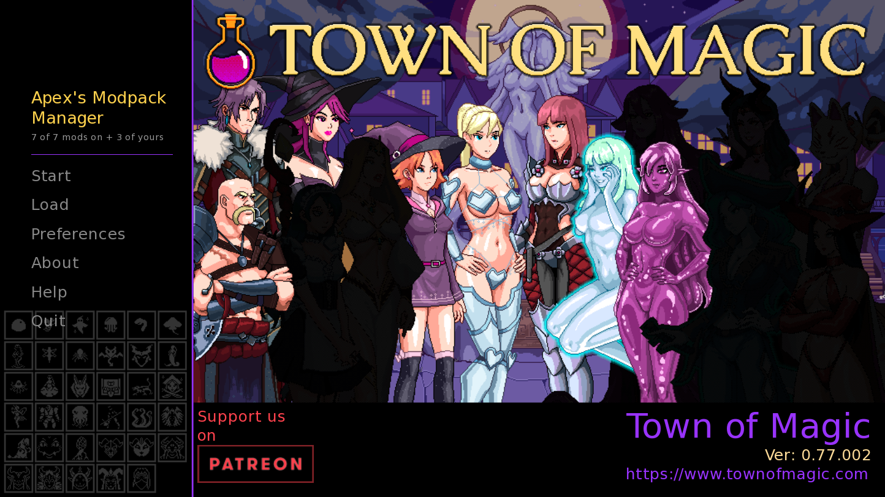

**Drag & drop · Switch every mod on or off in game · Tweak the settings · Add your own mods · Safe with game updates**

## ⬇️ [DOWNLOAD THE LATEST RELEASE](../../releases/latest)

| Download | What's inside | Last updated | Version | Size |
|---|---|:-:|:-:|--:|
| **Apex_Modpack** | All 15 mods + the Mod Manager + the mods folder (templates and the modding guide) | 2026-10-29 | v1.6.1 | 0.4 MB |
| **Apex_HD_Pack** part 1 of 3 | HD pictures for the HD x8 project (add-on, needs the modpack) | 2026-10-20 | [v1.5.2](../../releases/tag/v1.5.2) (unchanged) | 1.9 GB |
| **Apex_HD_Pack** part 2 of 3 | HD pictures, continued. Install all three parts. | 2026-10-20 | [v1.5.2](../../releases/tag/v1.5.2) (unchanged) | 1.9 GB |
| **Apex_HD_Pack** part 3 of 3 | HD pictures, the last part. | 2026-10-20 | [v1.5.2](../../releases/tag/v1.5.2) (unchanged) | 22 MB |

<sub>The HD Pack did not change in 1.6.1: use the three parts from the [v1.5.2 release](../../releases/tag/v1.5.2). Install steps are on the release page. Made for Town of Magic 0.77.002.</sub>

### ☕ Enjoying it?
Please support the game's developer, Deimus, first. If you'd still like to support the modpack's future development:

<a href="https://buymeacoffee.com/apex_modding"></a>

</div>

---

<div align="center">

## 📊 HD PROJECT — PROGRESS TOWARDS THE WHOLE GAME

</div>

<!-- PROGRESS:START -->
<!-- written by Tools/art/progress.py - run it (or build a release) to update -->
<div align="center">

#### ALL GAME ASSETS TO SCALE


<sub>An estimate of every game asset (the end goal). Updated with every release - v1.6.1, 29 Oct 2026.</sub>

#### CHARACTERS
<sub>every pose, face, outfit and animation frame of every character and creature</sub>


#### BACKGROUNDS
<sub>locations, window views, lights, animated backgrounds and event pictures</sub>


#### INTERFACE & ICONS
<sub>main menu art, world map, menus, item icons, symbols, effects and book pages</sub>


</div>

<details>
<summary><b>🧑‍🎨 Characters in detail — currently encountered in my own save (60 of 183 characters)</b></summary>

<div align="center">


</div>

<sub>Not encountered yet (123): Baron Everard, Bee-Girl, Bellona, Blightbloom, Booty, Busty, Capt. Ceres, Cedric, Celestian, Celica (child), Celica (fairy), Cellshroom, Cephrina, Cindy, Clara, Cozzy, Dark Cape, Dark Painting, Demon Sloth Blimp, Demon Sloth Dick, Domenea, Dwarf Guard, Dwarf Watch, Eeris, Elaran, Elith, Elize, Elyrana, Emma, Envy, Envy Demon, Fargrim, Faylen (spirit), Fire Golem, Fire Wyvern, Forest Hermit, Gaius, Galgatin, Galiene (spirit), Gavin, Genie, Genie Celica, Glace, Gluttony Demon, Gluttony's Tongue, Golem, Gorgroth, Graham, Greed Demon, Grimm, Grimmerock, Huge Slime, Ice Armor, Ice Golem, Inara, Kael, King Therbin, Kitsune, Layla, Lena, Leraie, Liamspirit, Lilith, Lily, Lucina, Luna, Lust, Lust Demon, Lyra, Lysander, Madame Samira, Mana Stalker, Margarilda, Masked Dwarf, Mindflayer, Mirania, Miriam, Nahla, Noctriel, Noctyra, Noxtar, Oberon, Penelope, Phantom Pirate, Phantom Sword, Pirate, Pixella, Pride Demon, Prince Rajak, Puck, Queen Brynja, Richard, Roderick, Rurik, Rusty, Saya, Shade, Skull Imp, Sloth Demon, Succubus, Sylphie, Sylvia, Talkstone, Tentaknight, Tessa, Topi, Trixi, Umbral Groper, Undead, Vaerandor, Valen, Velvetia, Vera, Violet, Vivi, Vivi's Panties, Voidgazer, Vorath, Warden, Wrath Demon, Xantherus, Yaiba, Zaid</sub>

</details>

<details>
<summary><b>🏞️ Backgrounds in detail</b></summary>

<div align="center">


</div>

</details>

<details>
<summary><b>🧭 Interface &amp; icons in detail</b></summary>

<div align="center">


</div>

</details>

<sub>A game asset is one image file of the game: a pose, a face, a piece of clothing, an animation sheet or a background layer.</sub>
<!-- PROGRESS:END -->

---

<div align="center">

## 🧰 THE MOD MANAGER

Everything happens in one place on the main menu — no file editing needed.

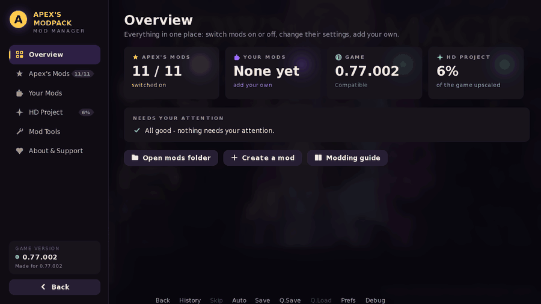

</div>

<details>
<summary><b>✨ What it does</b></summary>
<br>

| | |
|---|---|
| **Overview** | Everything at a glance: your mods, the game version check, HD progress, and anything that needs your attention. |
| **Apex's Mods** | Switch each of the pack's mods (and sub-mods) on or off. The ⚙️ gear changes a mod's settings. |
| **Your Mods** | Your own mods and mods you download, from the `mods` folder — with on/off, settings, details and plain-words error reports. |
| **HD Project** | How far the HD upscale is, per character and per area. |
| **Game Version** | Bottom left: your game version and Apex's latest GitHub version (each with a colored status dot), a **Check for updates** button, and a tick box *Disable automatic GitHub update checker* (otherwise it checks once when the game starts and offers **Download** / **No**). |
| **Mod Tools** | Create a mod from a template, check your mods for problems, export game pictures to edit, open the guide. |
| **About & Support** | Versions, compatibility, revisions of every mod, and support links. |
| **Restart prompt** | Changed something? It asks *"Restart now to apply changes?"* when you leave or quit. |

<div align="center">
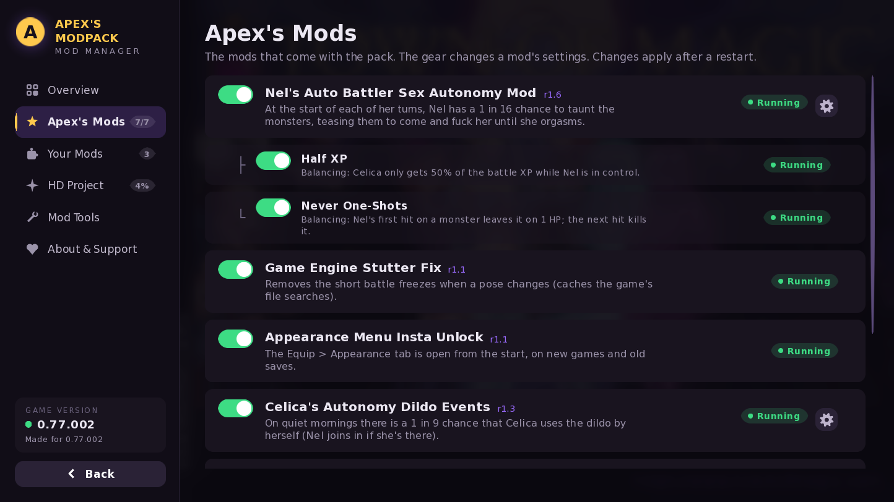 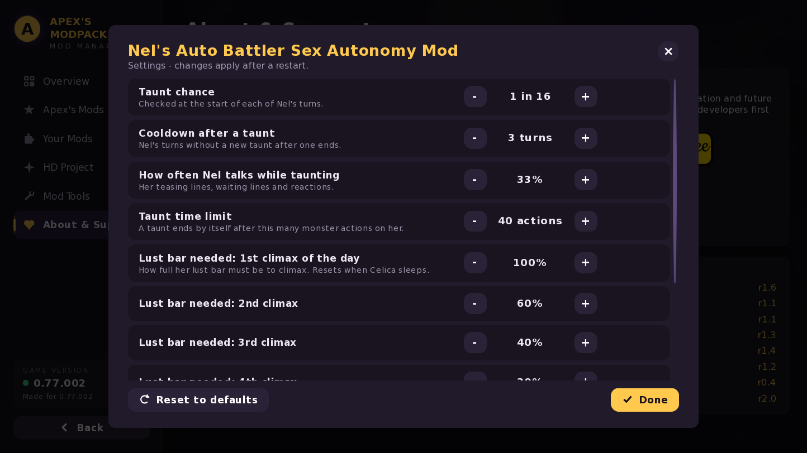
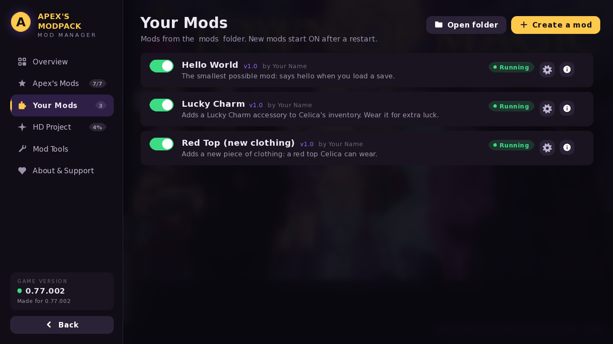 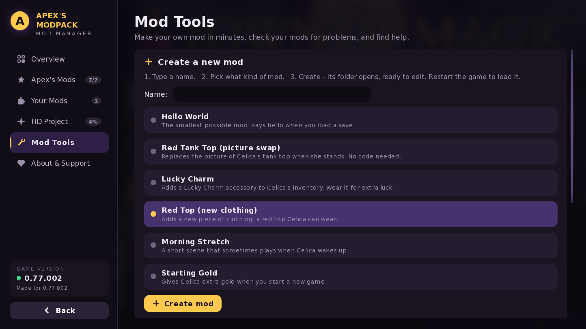
</div>
</details>

<details>
<summary><b>🛡️ Safe with game updates</b></summary>
<br>

- At start-up, every mod checks the exact game code it touches. If an update changed it, **only that mod switches itself off** and the game runs normally.
- Game newer than the modpack? Apex's mods switch off, the main menu tells you, and **Overview → Test modpack** lets you try them anyway.
- Green / orange / red version indicator, with a plain explanation.
- Every start writes `game/tom_mod_report.txt` — attach it to bug reports.
</details>

<details>
<summary><b>🧩 Your Mods — add your own (or other people's)</b></summary>
<br>

The modpack ships a **`mods`** folder next to the `game` folder. It's for everyone's own mods (Apex's mods live in `game/Apex_Modpack.rpa`).

- **Drop in a mod folder → restart → it's listed under Your Mods, switched on.**
- **Pictures replace the game's** — put a picture at the same path and name (e.g. `images/CHAR/celica/...`) and the game uses yours. No code needed.
- **Errors never crash your game.** A mod with an error is switched off, and *Your Mods → ⓘ* explains **where** it went wrong and **what to do**, in plain words. Even a typo that stops the game from starting is caught: restart once and the faulty mod is switched off and explained.
- **Settings for your mod** — a line in `mod_info.txt` gives your mod a ⚙️ gear in the manager.
- **Check my mods** finds missing files, wrongly sized pictures, clashes between mods and version mismatches.

<div align="center">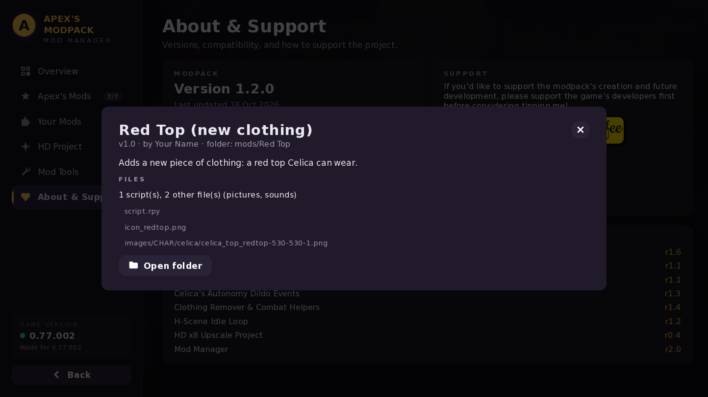</div>
</details>

<details>
<summary><b>📘 How-to guides & templates for modders</b></summary>
<br>

Six ready-made templates ship in `mods/_templates` — **Mod Tools → Create a new mod** copies one for you. The full **Modding Guide** is in `mods/_guide/Modding Guide.html`.

<details>
<summary>📦 Install someone's mod</summary>

1. Open your Town of Magic folder. Next to `game` is the `mods` folder.
2. Put the mod's folder inside `mods` (one folder per mod).
3. Start the game: it's under **Apex's Modpack Manager → Your Mods**, switched on.

To remove it, switch it off or delete its folder. Saves keep working.
</details>

<details>
<summary>🚀 Your first mod in 2 minutes</summary>

1. **Apex's Modpack Manager → Mod Tools**.
2. Type a name, pick **Hello World**, press **Create mod** — its folder opens.
3. Edit `script.rpy` in any text editor and change the message.
4. Restart the game and load a save.

```renpy
init python:
    def say_hello():
        if apex_setting("greet", True):
            apex_notify("Hello from my first mod!")
    apex_on_load(say_hello)
```
</details>

<details>
<summary>🖼️ Replace a game picture (no code)</summary>

Put a picture in your mod with the **same path and name** as a game picture:

```
game:     images/CHAR/celica/celica_top_normal-530-530-1.png
your mod: mods/My Mod/images/CHAR/celica/celica_top_normal-530-530-1.png
```

- Keep the **same size**. Names end in `-WIDTH-HEIGHT-FRAMES`: `-530-530-6` is 6 frames side by side.
- Get the originals: **Mod Tools → Export game pictures** (copies them to `mods/_exported` with the right names).
- Every pose is its own picture (`celica_top_normal` = standing, `celica_squat_top_normal` = squatting).
</details>

<details>
<summary>💍 Add an accessory with stats</summary>

```renpy
init python:
    apex_add_accessory("lucky_charm", "Lucky Charm", icon="charm.png",
                       description="A small charm that brings luck.",
                       stats={"luck": 10, "speed": 5}, regen=0)
```

Given once per save; worn from **Equip → Appearance**. Stats (0–100 scale): `allure`, `lewdness`, `willpower`, `cooldown`, `arcane`, `speed`, `luck`. `regen` = HP and MP back per battle turn, in %.
</details>

<details>
<summary>👗 How to create your own custom clothing</summary>

```renpy
init python:
    apex_add_clothing("red_top", "Red Top", area="top", picture="redtop",
                      icon="icon_redtop.png", description="A bright red top.",
                      stats={"allure": 5})
```

**Exact version** (the game's own fields): `equip_area=["top|0", "sleeves|1"]` is where it is worn (the first entry is the main area), `block_area=["top|1"]` is what it covers so nothing else fits there. Areas are `top`, `bottom`, `feet`, `head`, `sleeves`, each with a layer `|0` (inner) or `|1` (outer). Optional: `order`, `properties`, `stripable`, `molestable`, `extra={...}`.

The game draws clothing as its own picture on top of Celica, **one picture per pose**:

| area | word in the picture name | standing picture |
|---|---|---|
| top, bra | `top` | `images/CHAR/celica/celica_top_<picture>-530-530-1.png` |
| bottom, panties | `bottom` | `images/CHAR/celica/celica_bottom_<picture>-530-530-1.png` |
| shoes | `feet` | `images/CHAR/celica/celica_feet_<picture>-530-530-1.png` |

`<picture>` is your `picture=` word (`redtop` above). Other poses: `<pose>_top_redtop-<size>.png`. Poses without your picture show Celica without that piece — nothing breaks.
**Tip:** export `_top_normal` to get the normal top in every pose with the right names and sizes, recolor them, and rename `normal` to your word.
</details>

<details>
<summary>🌅 Add a morning scene</summary>

```renpy
init python:
    apex_wakeup_scene("my_scene", chance=0.2)      # 1 in 5 quiet mornings

label my_scene:
    "Celica stretches as the morning sun warms the room."
    celica "Today feels like a good day."
    $ apex_give_gold(10)
    return
```
</details>

<details>
<summary>⚙️ Settings players can change</summary>

Each line in `mod_info.txt` adds a row to your mod's ⚙️ gear:

```
setting = key | type | default | min | max | label shown to the player
setting = chance | 1 in n | 5 | 1 | 50 | Chance each morning
```

Types: `on/off`, `number`, `percent`, `1 in n`, `seconds`, `decimal`. In your script: `apex_setting("chance", 5)`.
</details>

<details>
<summary>🧱 All building blocks (the Apex Mod Kit)</summary>

| write this | what it does |
|---|---|
| `apex_setting("key", default)` | the player's choice for one of your settings |
| `apex_notify("text")` | a small message on screen |
| `apex_log("text")` | a line in `log.txt` in your mod folder |
| `apex_add_accessory(...)` / `apex_add_clothing(...)` | new items |
| `apex_give("id")` / `apex_give_gold(100)` | give an item again / give gold |
| `apex_on_new_game(f)` / `apex_on_load(f)` / `apex_on_wakeup(f)` | run your function at those moments |
| `apex_on_label("label", f)` / `apex_every(10, f)` | when the game reaches a label / every 10 seconds |
| `apex_wakeup_scene("label", chance)` | your scene on some quiet mornings |
| `apex_export("name part")` | copy matching game pictures to `mods/_exported` |

Your mod's name is found automatically from its folder. Advanced modders can use anything Ren'Py and the game offer — the kit is the safe, simple layer.
</details>

<details>
<summary>🩺 When something goes wrong</summary>

- **An error while playing:** the game keeps running, your mod is switched off, and **Your Mods → ⓘ** shows where and what to do. Full report: `ERROR REPORT.txt` in your mod folder.
- **The game crashed while starting** (usually a typo): restart once — the faulty mod is switched off and explained.
- **Mod Tools → Check my mods** finds missing files, wrongly sized pictures, clashes and version mismatches.

| you see | it means |
|---|---|
| name 'xyz' is not defined | a spelling mistake (capitals matter), or it's used before it exists |
| Couldn't find file | a picture or sound is missing or named differently |
| expected ':' / invalid syntax | a line that starts a block needs `:` at the end, or a quote/bracket isn't closed |
| unexpected indent | lines in one block must line up — use 4 spaces, not tabs |
</details>
</details>

---

<div align="center">

## 🎮 THE MODS
### (so far — bound to be a lot more)

Grouped like the in-game Mod Manager: **Characters**, **Clothing**, **Engine** and **UI**. Every mod has its own on/off switch.

<ins>**Rule of thumb: don't touch mod settings if you don't know what they do!**</ins>

</div>

<details>
<summary><h3>🧑‍🎨 CHARACTERS</h3></summary>

<details>
<summary><b>› Celica</b></summary>
<blockquote>

<details>
<summary><b>🌅 Celica's Autonomy Dildo Events (r1.4)</b></summary>
<div align="center">

On quiet mornings there's a **1 in 9 chance** that Celica uses her dildo by herself as soon as she wakes up, before she gets out of bed and stretches. If Nel is in the room, she joins in. It only happens when she owns the dildo, has 30+ Lewdness, is in her own body and nothing else is planned that morning.

⚙️ **Settings:** chance per morning (1 in 1 to 1 in 30), Lewdness needed (30 by default).


</div>
</details>

<details>
<summary><b>🔁 H-Scene Idle Loop (r1.2)</b></summary>
<div align="center">

On your turn, grope and H-scene animations <ins>**keep looping with their sounds and rotate between the animations of each monster currently groping her**</ins> instead of freezing on a still picture. It's purely visual and doesn't affect gameplay.

⚙️ **Settings:** sounds on/off, sound volume, switching on/off, switch timing.


</div>
</details>

<details>
<summary><b>🤖 Celica's Smart Auto Battle (r1.1)</b></summary>
<div align="center">

An **Auto Battle Mode: On/Off** button appears under the Attributes frame whenever **Explore** is available. Switch it on and Celica explores and fights by herself; switch it off at any moment, even in the middle of a fight, to take the controls back.

**How she fights** (the same computer control Nel's auto-battle uses, so every game rule still applies):<br>
**Focus kill:** she always attacks the monster with the least health (all equal: random, then she sticks with it)<br>
**Smart spells:** the spell with the most damage against *that* monster, worked out with the game's own formulas (element table, weaknesses and strengths, levels, Arcane). Damage beyond what the monster has left doesn't count, and a spell that kills is the cheapest one that does. Cooldowns and MP are respected<br>
**Struggling:** only when every monster holds her (or nothing can be cast)<br>
**Potions:** a Health Potion below a health limit, a Magic Potion when MP runs out, Cleanse or the matching Anti-potion for bad statuses<br>
**Between fights:** she checks the place she is in and crafts, in this order: **1.** the Anti-potion for every debuff the monsters there can cause (Confusion and Sleep in Misty Marsh, Poison for the hornets, Sleep for the fairies ...), only when its protection is not already on, **2.** one Health Potion, **3.** two Magic Potions, never more. She drinks the Anti-potion before exploring. She also clicks through the "you got" windows and presses Explore again<br>
**It stops by itself** when Explore is not available any more (energy 0, night, wrong place), when a **cut scene** starts (no fight, no clickable Explore, story text on screen: she never skips story scenes), when something needs a decision, when health is low and no potion is left, or when nothing is happening. A **report** (see Nel's Battle Report) opens when it ends, but only after at least 20 seconds of auto-play.

⚙️ **Settings:** Use potions, Craft potions (switched separately), Health Potion limit.

</div>
</details>

</blockquote>
</details>

<details>
<summary><b>› Nel</b></summary>
<blockquote>

<details>
<summary><b>👻 Nel's Auto Battler Sex Autonomy Mod (r1.8)</b></summary>
<div align="center">

When Nel possesses Celica and auto-battles, she sometimes stops fighting and **taunts the monsters**, teasing them to come and use Celica's body until she climaxes. Monsters grab, grope and tear her clothes, Nel comments on it in her own voice, then she shoos them off and goes back to fighting.

**Features**<br>
1 in 16 chance at the start of each of her turns (adjustable)<br>
**Climax ladder:** each climax in the same day needs less lust (100% → 60% → 40% → 30% → 20%). It resets when Celica sleeps.<br>
Nel only talks some of the time while taunting, so it doesn't turn into spam<br>
Celica takes no damage while Nel is taunting or climaxing<br>
Nel only gains 0.5 body influence per climax instead of the game's 10<br>
**Balancing options (switch separately):** **Half XP** — Celica only gets 50% of the battle XP while Nel is in control (adjustable) · **Never One-Shots** — Nel's first hit leaves a monster on 1 HP<br>
⚙️ **Settings:** taunt chance, cooldown, how often she talks, taunt time limit, lust needed for climaxes 1 to 5+, XP share, body influence.


</div>
</details>

<details>
<summary><b>📋 Nel's Battle Report (r1.2)</b></summary>
<div align="center">

When Nel leaves Celica's body after an auto-battle ("Bye…!"), a **report sheet** shows everything she did while she was in control:<br>
the **monsters** she defeated (with their pictures), **battle XP and skill XP** added up, **gold**, how many times she **invited the monsters**, her climaxes, the number of battles and how long it all took. **Items** run along the bottom, rarest first, in frames that get fancier with rarity (epic items pulse, legendary ones shine).

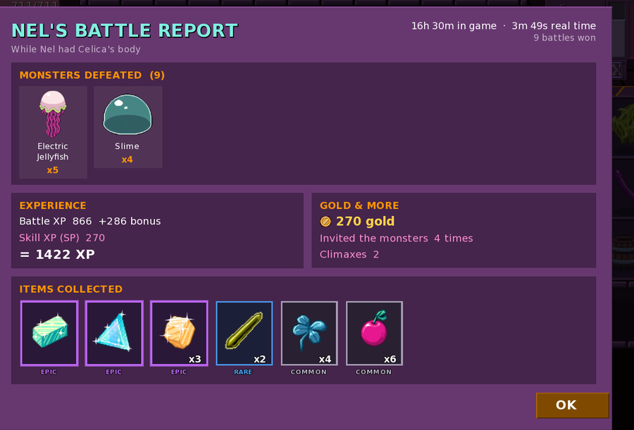

</div>
</details>

</blockquote>
</details>

</details>

<details>
<summary><h3>👗 CLOTHING</h3></summary>
<blockquote>

<details>
<summary><b>👗 Appearance Menu Insta Unlock (r1.1)</b></summary>
<div align="center">

The **Equip > Appearance** tab is open from the very start, on new games and on old saves. You don't need to unlock the tailor first.


</div>
</details>

<details>
<summary><b>❌ Clothing Remover (r1.6)</b></summary>
<div align="center">

**Red-X Shoes / Top / Pants:** equippable "nothing" items that fully remove that clothing, including its protective combat states, so she stays exposed. Stats: Allure/Lewdness +25; Willpower, Cooldown, Arcane and Speed −25.

**Click to remove:** in **Equip > Appearance**, click a piece in the EQUIPPED list to take it off, click again to put it back. Taking off a bra or panties also takes off the top or pants over it. Violet's suits and hair are left alone. (The game only allows this where changing clothes is allowed, e.g. not in hostile places.)

⚙️ **Settings:** red-X stat strength.

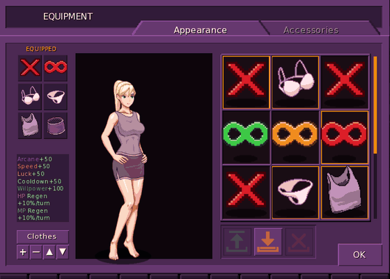

</div>
</details>

<details>
<summary><b>♾️ Combat Helpers (r1.0)</b></summary>
<div align="center">

**Green / Orange / Red** accessories with 10% / 50% / 100% of Speedster's Blessing stats, for when the fights get too hard. One at a time; they aren't drawn on her.

⚙️ **Settings:** the strength of each helper.

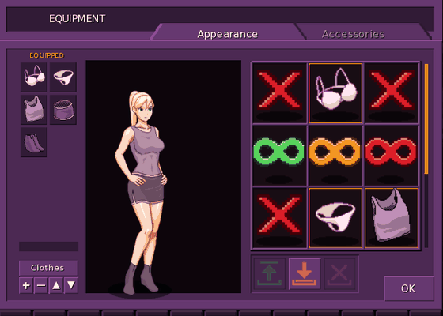

</div>
</details>

</blockquote>
</details>

<details>
<summary><h3>⚙️ ENGINE</h3></summary>
<blockquote>

<details>
<summary><b>⚡ Game Engine Stutter Fix (r1.3)</b></summary>
<div align="center">

Removes the short **~0.2–0.4 s freezes** in battle: when a character changes pose, after a battle ends or you wake up, and the periodic freeze from Python's memory clean-up. The whole game feels way smoother and snappier.

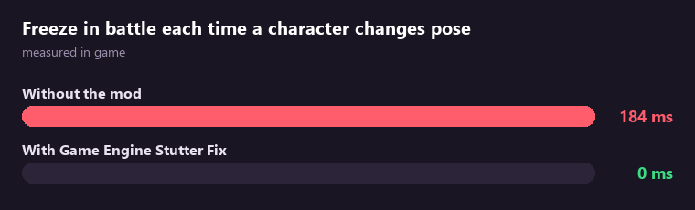

</div>
</details>

<details>
<summary><b>🖼️ HD x8 Upscale Project (r0.7) — VERY EARLY WIP</b></summary>
<div align="center">

AI-upscaled HD pictures, used automatically when your window is bigger than 1066×600 (1080p, 1440p, 4K). All backgrounds and **all menus, icons, symbols, the main menu and the world map** are done; characters are done a block at a time — see **HD Project progress** above. Needs the **Apex_HD_Pack** download.

**HD Toggle:** press **F8** or click the **HD Toggle** button under Health and Magic to switch every HD picture (characters, backgrounds, items, icons and menus) back to the original and back again, instantly.<br>
⚙️ **Settings:** picture memory.

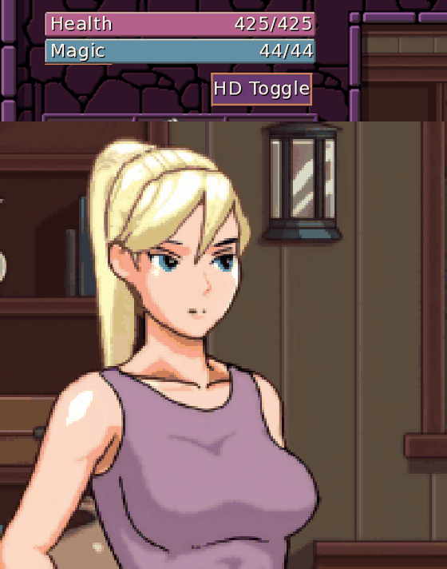

</div>
</details>

</blockquote>
</details>

<details>
<summary><h3>🧭 UI</h3></summary>
<blockquote>

<details>
<summary><b>🎒 Inventory Scroll Mod (r1.1)</b></summary>
<div align="center">

Every item grid scrolls with the **mouse wheel** instead of paging with arrows, and grows a new row whenever it's nearly full (7 of 9 squares, 10 of 12, ...): **ITEMS** and **SPELLS**, and **Appearance** and **Accessories** in Equip.

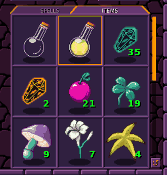 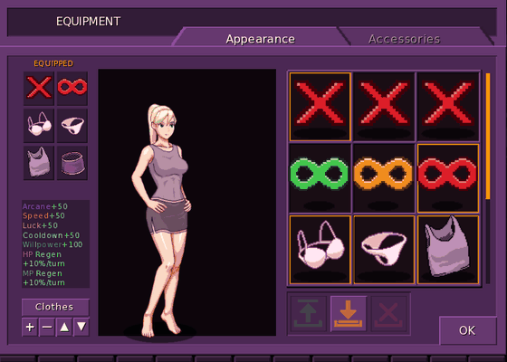

</div>
</details>

<details>
<summary><b>🧪 Morden's Lab Craftable Catalog (r1.0)</b></summary>
<div align="center">

In Morden's Lab, a **CATALOG** button appears between the two glass capsules. It lists **only the upgrades you can make right now** (both ingredients owned and usable). Click one and both items are put in Item 1 and Item 2 — then press **FUSE** as usual. Each ingredient says where it is ("Equip > Accessories", "worn"). The recipes come straight from the game, so they're always exact, even after game updates.

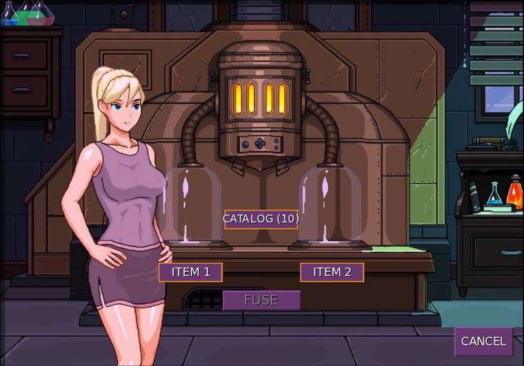 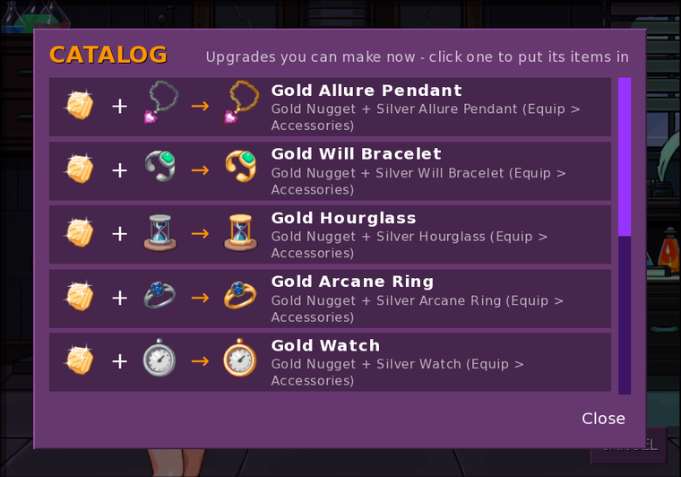

</div>
</details>

<details>
<summary><b>✋ Movable Inventory Items (r1.0)</b></summary>
<div align="center">

Hold the left mouse button on an item, drag it onto another square and let go: the two swap places. Works in every grid of the Inventory Scroll Mod (needs it on). While you drag, a faded copy stays in the original square; let go anywhere that isn't a square of the same grid and nothing moves — nothing can be dragged onto worn or equipped slots.<br>
**Item safety:** only *where* each item is drawn is remembered — the game's items are never added, removed or moved. Every item is always shown exactly once (stress-tested with 180,000 random inventory changes). While another window is open (a shop, the map, a question), the inventory doesn't react — just like the game's own.

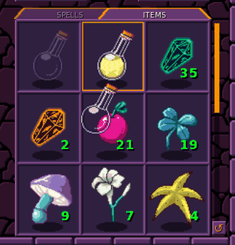 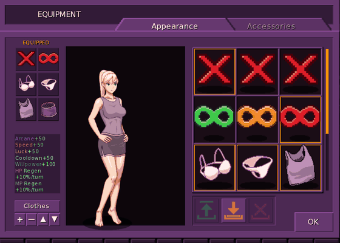

</div>
</details>

<details>
<summary><b>↺ Inventory Backups (r1.0)</b></summary>
<div align="center">

Each time you arrive somewhere new, a backup of your items and gold is kept (the last 5 places). The small **↺** button under the inventory opens the list and shows exactly what comes back, what is removed and how your gold changes before anything is put back. Clothes and accessories you're wearing stay on. Not possible during battles or scenes.

⚙️ **Settings:** how many backups to keep (0 = off).

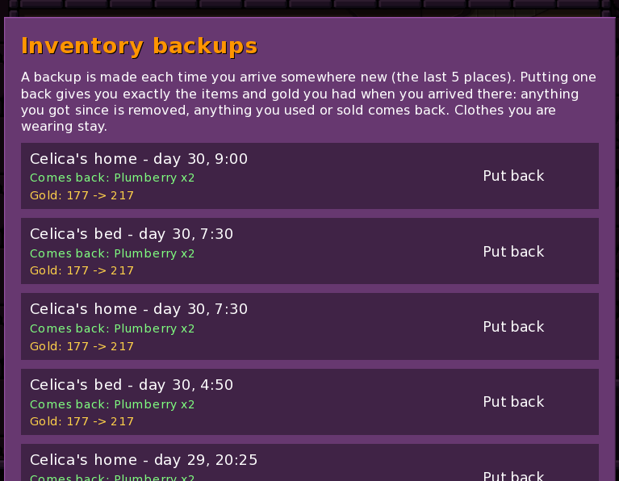

</div>
</details>

<details>
<summary><b>⌨️ WASD Map Movement (r1.0)</b></summary>
<div align="center">

Move around the map with **W, A, S, D** as well as the arrow keys. The big purple arrows on the map border can still be clicked. Nothing is saved and no game setting changes: the mod only adds the four letters to the keys the map arrows already listen to.

</div>
</details>

</blockquote>
</details>

---

<div align="center">

## 📝 CHANGELOG & FAQ

</div>

<details>
<summary><b>Changelog</b></summary>

**v1.6.1**
- New: custom clothing can use the game's own fields: `apex_add_clothing(... equip_area=[...], block_area=[...], order=..., properties=[...], stripable=..., molestable=..., extra={...})`; `area=` still works. Mistyped areas are explained in the Mod Manager

**v1.6.0**
- New mod: **Celica's Smart Auto Battle** (button under the Attributes frame): she explores and fights by herself with focus kills, damage-based spell choice, region-aware potion crafting (Anti-potion for the place's debuffs, then 1 Health, then 2 Magic) and a stop when a cut scene starts
- New mod: **WASD Map Movement**: move around the map with W, A, S and D as well as the arrow keys
- Changed: Nel's Battle Report also covers Celica's auto battles and only opens after at least 20 seconds of auto-play

**v1.5.2**
- New: **mods made by others** (a `game` folder, as downloaded) work from `mods\<ModName>\game`; they replace the game's files like a normal install
- New: **Game Version panel** with your game version, Apex's GitHub version, a Check for updates button and *Disable automatic GitHub update checker*
- Fixed: a mod that errors every frame is reported once; Nel's Battle Report scrolls with very many monsters

**v1.5.1**
- Fixed: the **HD Toggle** / F8 now switches *everything* (backgrounds, items, icons, menus), not only characters
- New: **click-to-remove** clothing in Equip > Appearance (click worn clothes in the EQUIPPED list; bra/panties also take off what covers them)
- Fixed: **Nel's auto-battle stuck kissing** (Rock Spitters in Dimore Cave never made her climax while she wore Violet); Rock Spitter kisses now give 3x lust while Violet is worn
- HD: more Celica, Dark Knight, Slime Girl, Nel, Bert and Barkeeper pictures

**v1.5.0**
- New: **Update checker** in the Mod Manager (start-up check with a Download / No prompt, plus a manual button above Game Version)
- New: **Nel's Battle Report** and **Morden's Lab Craftable Catalog**
- HD: **every menu, icon, symbol, the main menu and the world map** are now HD (upscale only, so text and symbols stay exact); HD pack is now 2 parts
- Fixed: Celica had **no face** during some of Nel's taunts
- Stutter Fix 1.3: removes the periodic memory-clean-up freeze
- Inventory: the game's own grid is used while a shop, Equip or a question is open, so dialogs always cover it
- Every problem a mod catches is now written to `game/apex_mod_errors.txt`

**v1.4.0**
- **The Mods** and the Mod Manager are grouped by category: Characters (Celica, Nel), Clothing, Engine, UI
- Every mod is now standalone with its own switch: **Clothing Remover** and **Combat Helpers** are separate; **Movable Inventory Items** and **Inventory Backups** are their own mods
- The **Inventory Scroll Mod** now covers every grid (ITEMS, SPELLS, Appearance, Accessories)
- New GIFs and pictures for the mods and the Mod Manager

**v1.3.0**
- New: **Inventory Scroll Mod** + Movable Inventory Items, with inventory backups
- New: **Appearance/Accessories Scroll Mod** + Movable Equip Clothing/Accessories Mod
- HD x8: **HD Toggle** button and **F8** to switch HD on and off instantly
- Celica's Autonomy Dildo Events: the scene now plays as she wakes, before she gets up and stretches
- Mod Manager: mods are listed alphabetically

**v1.2.0**
- Brand-new Mod Manager: sidebar with Overview, Apex's Mods, Your Mods, HD Project, Mod Tools, About & Support
- **Your Mods:** a `mods` folder for everyone's own mods — on/off, settings, details, plain-words error reports, crash recovery
- **Apex Mod Kit + 6 templates + Modding Guide:** accessories, custom clothing, picture swaps, morning scenes, new-game bonuses
- Mod Tools: create a mod from a template, check my mods, export game pictures
- HD Project page and progress tracking towards the whole game
- Split downloads: the modpack (tiny) and the HD pack
- HD backgrounds (first block) and many more HD characters

**v1.1.0**
- Gear settings for every mod that has something to tweak
- Nel sub-mods: Half XP / Never One-Shots
- Game version check, "Test modpack" master switch
- Scrolling mod lists, many small fixes

**v1.0.0**
- First release: 7 mods + Apex's Modpack Manager
</details>

<details>
<summary><b>FAQ</b></summary>

**Does it work with my saves?** Yes, old saves and new games. Removing the pack doesn't break saves either.<br>
**Can I use only some mods?** Yes — switch the rest off in the manager.<br>
**Do I need the HD pack?** No. Without it the game looks as usual; the HD x8 mod just has nothing to show.<br>
**Does it work on other versions?** It's made for 0.77.002. On newer versions Apex's mods switch themselves off until you choose to test them.<br>
**Can I share my own mods?** Yes — zip your mod's folder; others drop it into their `mods` folder.<br>
**Android / Mac?** Only tested on Windows.
</details>

---

<div align="center">

Bug reports and suggestions are welcome in [Issues](../../issues). For problems, include your `game/tom_mod_report.txt`.

<sub>For modders: the pack's own sources are in `Mods/`, `Tools/build_modpack.py` builds the release, `Tools/art` + `Tools/upscale` hold the HD pipeline.<br>Fan-made mod; not affiliated with Deimus. Town of Magic and its assets belong to their creator.</sub>

</div>
