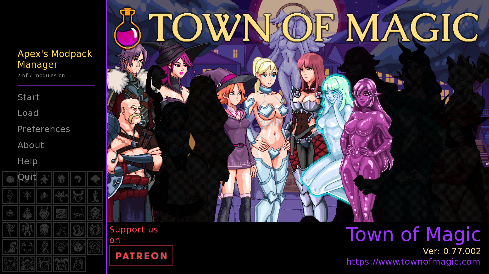
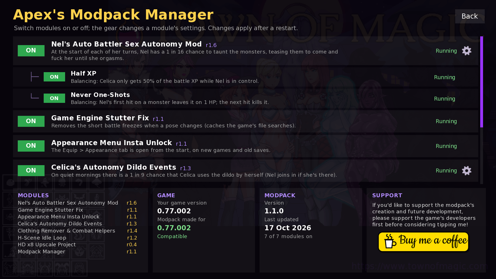
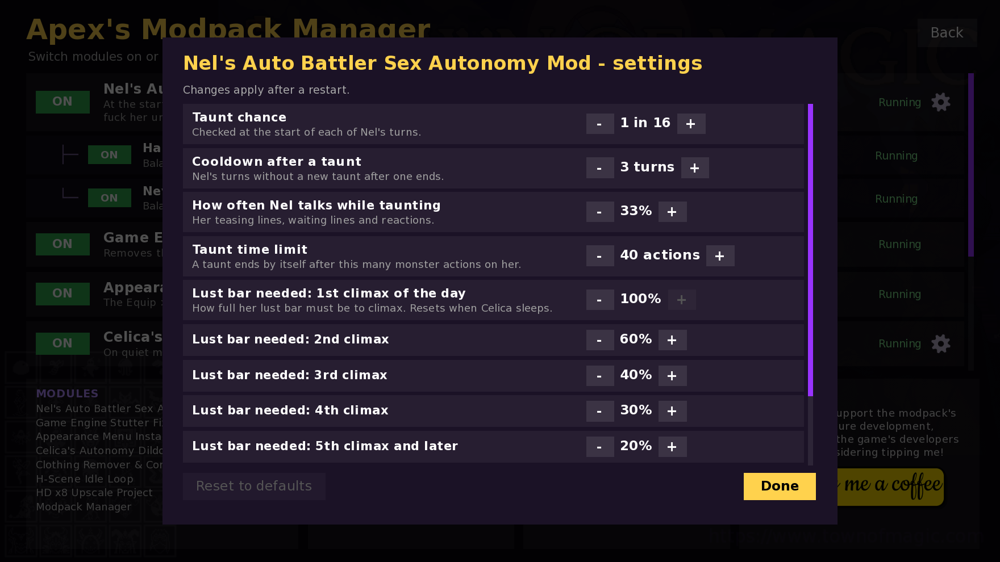
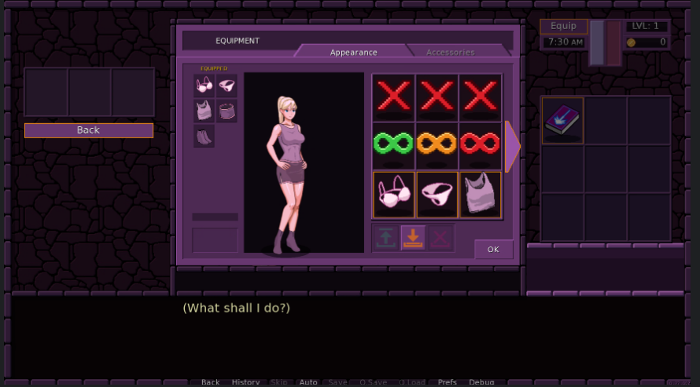
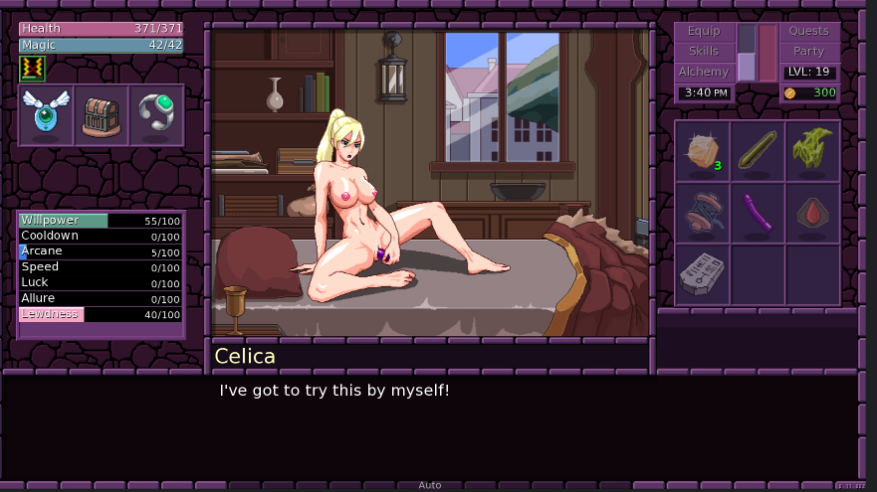
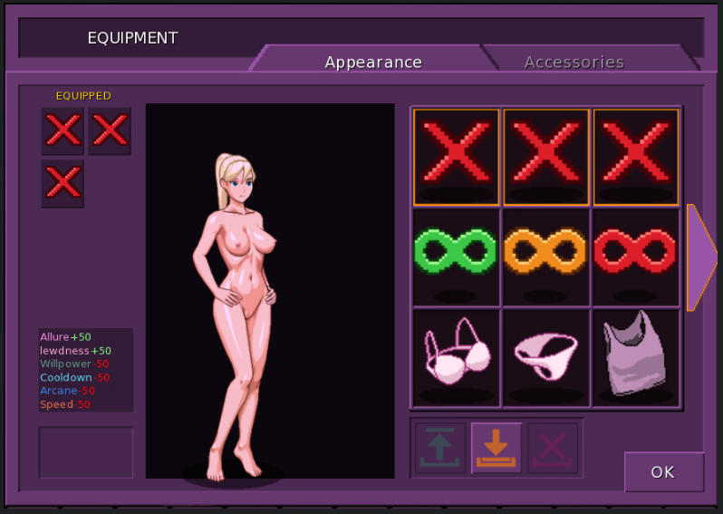
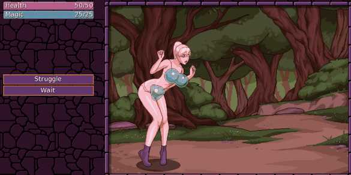
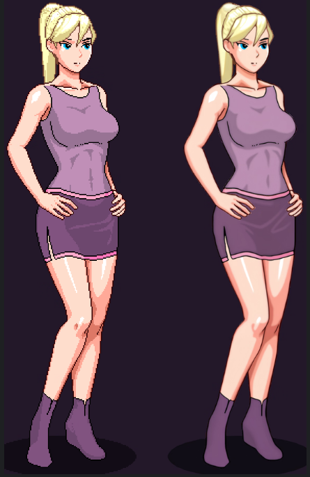
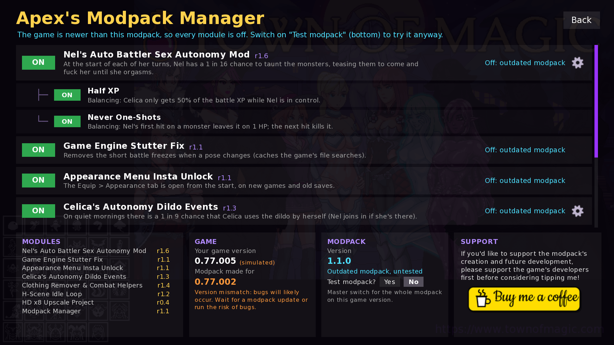

# APEX'S MODPACK AND MOD MANAGER
### for Town of Magic v0.77.002 — 7 Mods, one file, one in-game manager, and many more mods to come.

**Drag & drop · Toggle every module in-game · Tweak the settings · Safe after game updates**

### ⬇️ [DOWNLOAD THE LATEST RELEASE](../../releases/latest) ⬇️

---

## BACKGROUND - BEFORE YOU DOWNLOAD!

This is my first ever post on F95. I've been an admirer from afar of this community, but after working on this project I wanted to give back to the community that has given so much to me!

I've been a long-time fan of Town of Magic and have played it a few times over with each new update, but I found myself wanting a little more in some cases: things that feel more alive and interactive, some QoL changes and, ultimately, just more porn lol. So I ended up tinkering around with the game and making my first mod.

It started with the H-Scene/Groping Loop mod. After playing around with it and getting it to work, I got used to it and even found it fun to see my idea come to life and play out how I wanted it to... then that idea spread to the rest of the game as I played through it again, adding more and more mods.

As of writing, there are currently 7 Mods + The Mod Manager.
I plan to add many more as I continue to play the game and ideas come to me.

**Claude was used in the making of this!**
I know AI is a grey area right now, but it quickly became my best friend while working on this project. I initially started coding myself and got the majority of the mods fleshed out, but after a while I ran into bugs, errors and crashes and looked for help.
Its incredible debugging knowledge gave me the tools I needed to keep going with the project, and it even made the game run way smoother and snappier, which blew my mind.

This modpack has been extensively stress tested and I'm happy to say it works incredibly well.

I'm having quite a lot of fun modding these games, and I'm seriously contemplating extending to other games I've played and loved in the past, to give them a lil more gooner juice, or even by popular request (which I've gotta figure out how to do lol).
For now, if you like this project, leave a ⭐ on the repo (or a react on the F95 post) so I can gauge how much interest there might be!

With all of that said, thank you all for what you've given me. It's time to start giving back to you. 💖

---

## THE MODPACK MANAGER

Everything is controlled from the main menu, so you never have to edit files. 
**ON / OFF switch** for every module and sub-module 
⚙️ **Gear** on each module: change chances, volumes, strengths and more 
Shows each module's **revision**, your game version and the date of the last update 
Changed something? It asks *"Restart now to apply changes?"* when you leave the manager or quit the game

---

## THE MODS
### (SO FAR - BOUND TO BE A LOT MORE)

<ins>**Rule of thumb: don't touch module settings if you don't know what they do!**</ins>

<b>👻 Nel's Auto Battler Sex Autonomy Mod (r1.6)</b>

### What it does
When Nel possesses Celica and auto-battles, she sometimes stops fighting and **taunts the monsters**, teasing them to come and use Celica's body until she climaxes. Monsters grab, grope and tear her clothes, Nel comments on it in her own voice, then she shoos them off and goes back to fighting.

**Features** 
1 in 16 chance at the start of each of her turns (adjustable) 
**Climax ladder:** each climax in the same day needs less lust (100% → 60% → 40% → 30% → 20%). It resets when Celica sleeps. 
Nel only talks some of the time while taunting, so it doesn't turn into spam 
Celica takes no damage while Nel is taunting or climaxing 
Nel only gains 0.5 body influence per climax instead of the game's 10 
**Sub-modules (toggle separately)** 
**Half XP:** Celica only gets 50% of the battle XP while Nel is in control (adjustable) 
**Never One-Shots:** Nel's first hit leaves a monster on 1 HP, so it actually gets a turn 
⚙️ **Settings:** taunt chance, cooldown, how often she talks, taunt time limit, lust needed for climaxes 1 to 5+, XP share, body influence.

<b>How it works</b>

Hooks `enemy_decides` (picks Nel's custom "taunt" turn and forces the monsters' grab/molest moves), `enemy_mod_hp` (damage immunity + the 1 HP rule), `attribute_mod` (climax-ladder threshold), `body_influencelvl_mod` and `print_reward_message` (XP share). It uses the game's own animations, clothing-tear effects and climax status, so nothing is faked. Per-battle state is stored in the game's battle variables, and settings are re-applied whenever you load a save.

<b>⚡ Game Engine Stutter Fix (r1.1)</b>

### What it does
Removes the short **~0.2–0.4 s freeze** in battle whenever a character changes pose. Measured: 184 ms → 0 ms per pose change. The whole game will feel way smoother and snappier.

<b>How it works</b>

The game searches its whole file list every time it builds a pose. This module caches those searches (`list_files_match / _regex / _containing`), so each search only runs once. Results are identical; they just come back instantly.

<b>👗 Appearance Menu Insta Unlock (r1.1)</b>

### What it does
The **Equip > Appearance** tab is open from the very start, on new games and on old saves. You don't need to unlock the tailor first.

<b>How it works</b>

Calls the game's own unlock function (the one the tailor uses) as soon as a new game has finished setting up, and again after every load.

<b>🌅 Celica's Autonomy Dildo Events (r1.3)</b>

### What it does
On quiet mornings there's a **1 in 9 chance** that Celica uses her dildo by herself when she wakes up. If Nel is in the room, she joins in. It only happens when she owns the dildo, has 30+ Lewdness, is in her own body and nothing else is planned that morning.

⚙️ **Settings:** chance per morning (1 in 1 to 1 in 30), Lewdness needed (30 by default).

<b>How it works</b>

Hooks the wake-up routine. When the game hasn't picked a morning scene, the mod puts the game's own dildo scene in that slot, so it plays exactly like the vanilla one.

<b>❌ Clothing Remover & Combat Helpers (r1.4)</b>

### What it does
**Red-X Shoes / Top / Pants:** equippable "nothing" items that fully remove that clothing, including its protective combat states, so she stays exposed. Stats: Allure/Lewdness +25; Willpower, Cooldown, Arcane and Speed −25. 
**Combat Helpers (Green / Orange / Red):** accessories with 10% / 50% / 100% of Speedster's Blessing stats, for when the fights get too hard. 
⚙️ **Settings:** red-X stat strength, the strength of each helper.

<b>How it works</b>

Adds real game items (they show up in the Appearance tab) and hooks the clothing/equip functions so the game doesn't put clothes back on her. If you change a strength, the item's stats are updated on load, including on items she's already wearing.

<b>🔁 H-Scene Idle Loop (r1.2)</b>

### What it does
On your turn, grope and H-scene animations <ins>**keep looping with their sounds and dynamically rotate between the animations of each monster currently groping her**</ins> instead of freezing on a still picture. With several monsters on her, it switches between their animations every few seconds. It's purely visual and doesn't affect gameplay.

⚙️ **Settings:** sounds on/off, sound volume, switching on/off, switch timing.

<b>How it works</b>

Watches for your idle turn while Celica is grabbed, replays the last molest animations from the monsters on her, and plays their frame-synced sounds quietly, one at a time. It stops the moment you act or a monster takes its turn.

<b>🖼️ HD x8 Upscale Project (r0.4) — VERY EARLY WIP</b>

### What it does
Upscaled HD sprites, used automatically when your window is bigger than 1066×600 (1080p, 1440p, 4K). Done so far: Celica, the slime fight and Nel's possession. More characters are coming.

⚙️ **Settings:** picture memory.

<b>How it works</b>

Every frame is upscaled x8 with a fixed AI pipeline (ESRGAN-style upscale, colour matching, tile-ControlNet detailing; faces kept close to the original), then shipped as `@2` files that Ren'Py picks up natively. The game stacks body, clothes and face layers on the CPU, so the module re-stacks those layers on the GPU whenever HD files exist. It loads the full sprite sheets without stutter.

---

## SAFE WITH GAME UPDATES

Every module checks, at start-up, the exact game code it touches. If an update changed it, **only that module switches itself off** and the game runs normally. 
Game newer than the modpack? Every module switches off, the main menu tells you, and you can choose **"Test modpack?" → Yes** to try it anyway. 
Green / orange / red version indicator and explanation in the manager. 
Every start writes a `tom_mod_report.txt`. Post it in an issue if something breaks.

---

## DOWNLOAD
**[Apex's Modpack — latest release](../../releases/latest)** (~181 MB, mostly HD sprites) 
Game Ver: **Town of Magic 0.77.002**

## INSTALL
1. Open your Town of Magic folder (the one with `TownOfMagic.exe`). 
2. Drag the `game` folder from the zip into it → **merge / replace**. 
3. Start the game. **Apex's Modpack Manager** sits at the top of the main menu.

## UNINSTALL
Delete `game\Apex_Modpack.rpa`. Your saves keep working, both with and without the pack.

## CHANGELOG

<b>Changelog</b>

**v1.1.0**
- Gear settings for every module that has something to tweak
- Nel sub-modules: Half XP / Never One-Shots
- Game version check, "Test modpack" master switch
- Scrolling module lists, many small fixes

**v1.0.0**
- First release: 7 modules + Apex's Modpack Manager

## FAQ

<b>FAQ</b>

**Does it work with my saves?** Yes, old saves and new games. Removing the pack doesn't break saves either. 
**Can I use only some modules?** Yes. Switch the rest off in the manager. 
**Does it work on other versions?** It's made for 0.77.002. On newer versions it switches itself off until you choose to test it. 
**Android / Mac?** Only tested on Windows.

---

### ☕ Enjoying it?
Please support the game's developer, Deimus, first. If you'd still like to support the modpack's future development:

Bug reports and suggestions are welcome in [Issues](../../issues). For problems, include your `tom_mod_report.txt`.

For modders: module sources are in `Mods/`, `Tools/build_modpack.py` builds the one-file pack, and `Tools/upscale/` holds the HD pipeline. The workspace `README.txt` has the details. Fan-made mod; not affiliated with Deimus. Town of Magic and its assets belong to their creator.

